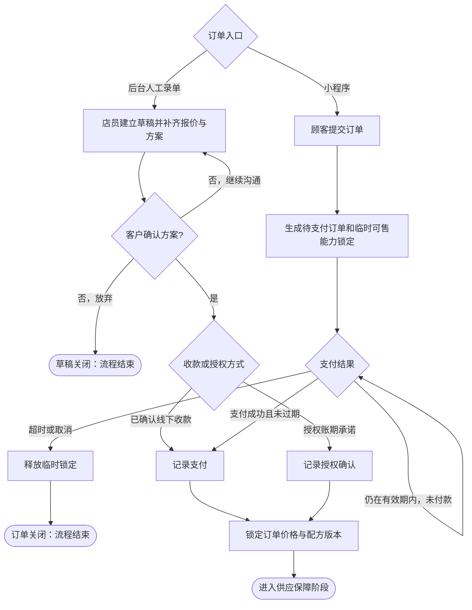
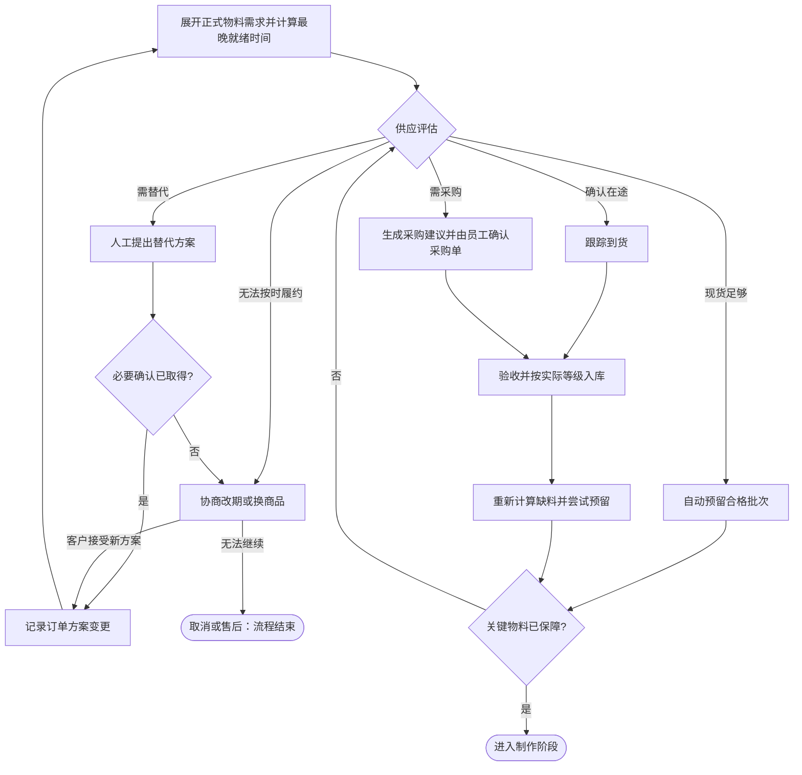
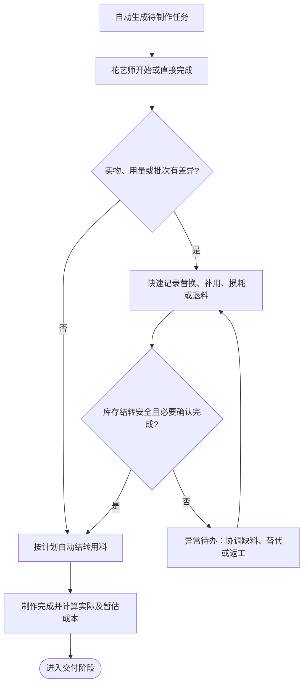
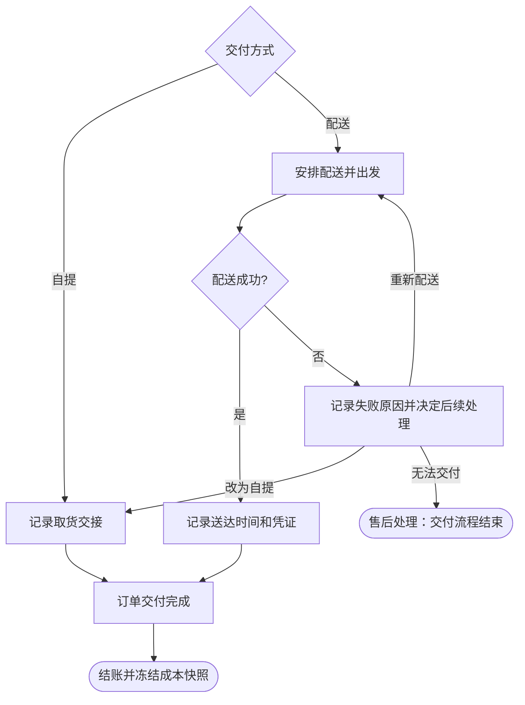

# Flower Studio 2.0：下单到配送完成业务流程

状态：业务设计图，依据 [2.0 领域设计稿](flower-studio-2.0-domain-design.md)；用于流程评审和试用验证。

下面分四段阅读。每段只展示该阶段的判断；“关闭”与“取消”均为终点，只有成功出口进入下一段。

### 1. 下单与履约确认

### 2. 供应保障

### 3. 制作与库存结转

### 4. 交付与结账

## 流程口径

1. 小程序待支付阶段只短时锁定可售能力，不指定具体批次；支付成功后释放临时锁定并尝试正式预留。后台人工订单可经授权账期等方式进入履约，无须模拟线上支付。
2. “已收款”“供应已保障”“制作完成”“已交付”分别记录。付款成功但暂时缺料的订单进入供应风险处理，不显示为可制作。普通小程序订单在支付前要通过可行性判断；明确预约商品可使用预约规则。
3. 到货按实际验收等级入库。低等级替代高等级需人工确认；客户可感知变化还需客户确认。采购延期会提示受影响订单。
4. 正常制作无需分配负责人、逐项领料或逐枝填写用量。系统自动选择批次并结转；数量、批次不可信时停止自动扣料，由员工处理差异。
5. 配送失败和退款不会自动恢复已消耗花材。可回库数量要按实际阶段确认。自提与配送均以实际交接完成为交付终点。

图中“待采购 → 到货”可能跨多天；在途、客户确认和制作异常均应在今日工作台持续显示，而不是要求员工反复手动推进状态。
