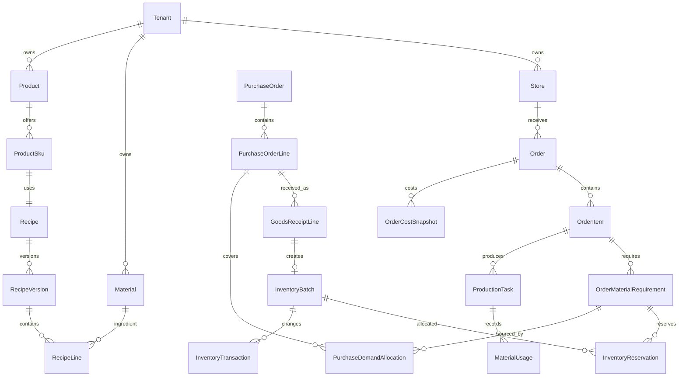

# Flower Studio 2.0 实体关系与 Prisma Schema 草案

状态：供评审的目标模型，尚未替换 `flower-wms-system/prisma/schema.prisma`，未运行迁移。业务规则以 [领域设计稿](flower-studio-2.0-domain-design.md) 为准。

## 关系主线

## 建模选择

- 业务根实体用 `tenantId`；门店操作实体同时用 `storeId`。跨租户引用必须由服务层校验，必要的数据库复合外键在 SQL migration 中补强。
- 金额 `Decimal(14,2)`，单价与单位成本 `Decimal(14,4)`；库存数量 `Decimal(14,3)`，但每个物料另设 `quantityScale`，枝、块、卷为 0，只允许整数。数据库 `CHECK` 约束补强非负数量。
- `Material` 是物料身份；`MaterialGrade` 可用代码/说明表示等级标准。等级是物料属性，批次保留验收等级快照。供应商与来源不是物料身份。
- `InventoryBatch` 标识来源和成本；位置余额另由 `BatchBalance` 表承载。流水不可覆盖；余额是事务内更新的投影，可用流水核对。
- `AvailabilityHold` 在待支付时锁定 SKU 可承诺能力，并保存当时展开的需求快照；支付后释放锁定并建立批次预留，两个动作在同一事务中完成。未来预约订单可有不依赖现货的承诺策略。
- `OrderItem` 保存名称、售价、规格和配方版本快照引用；定制项 `skuId` 可为空，但确认前必须有计划行。`OrderMaterialRequirement` 是订单计划行，订单变更形成新 revision，旧版本留存。
- `ProductionTask` 可无负责人；直接完成时服务自动补齐默认用料结转。`MaterialUsage` 仅记录实际结算行及差异原因，正常路径可自动生成。
- `CostEntry` 按成本类别保存暂估与最终值；`OrderCostSnapshot` 保存结账口径；结账后的变化写 `CostAdjustment`，不覆盖历史快照。

## 拟建实体与关键字段

| 领域 | 实体 | 关键字段与约束 |
|---|---|---|
| 组织 | Tenant, Store, InventoryLocation | `Store(tenantId,code)`、`Location(storeId,code)` 唯一；位置类型仓库/制作区 |
| 身份 | StaffUser, TenantMember, StoreMember | 成员可拥有多职责；业务权限由服务端成员关系解析 |
| 物料 | Material, MaterialCategory, SupplierMaterial | `Material(tenantId,code)` 唯一；类型、品种、颜色、等级、规格、基础单位、`quantityScale`、是否逐单预留 |
| 商品 | Product, ProductSku | `(tenantId,code)` 唯一；SKU 价格和预约规则；可售数是计算结果，不作库存事实 |

商品表以 `defaultSkuId` 指向默认 SKU。保存商品时校验该 SKU 属于当前商品；上架时校验它可售且至少一个 SKU 可售。当前 Prisma 关系只保证目标 SKU 存在，跨行“属于本商品”的约束需要在服务事务中校验，并可在 SQL migration 中以复合外键加强。商品创建与编辑界面允许管理所属 SKU、逐个定价和切换默认 SKU；订单继续保存下单时的 SKU 与售价快照。

SKU 的 `active` 与是否有库存分别判断。默认 SKU 售罄时前台临时预选第一个有货且启用的 SKU，不修改 `defaultSkuId`；全部售罄时仍展示商品但禁用购买。停用默认 SKU 前必须重新指定默认 SKU；停用最后一个启用 SKU 前必须先下架商品。历史订单保留原 SKU 引用。
| 配方 | Recipe, RecipeVersion, RecipeLine | `(recipeId,versionNo)` 唯一；发布版本不可修改；行含标准用量、容差、预计损耗、成本方式 |
| 订单 | Order, OrderItem, OrderRevision, OrderMaterialRequirement | 商业/供应/制作/交付状态分列；渠道与创建入口分列；需求行按 revision 留存 |
| 库存 | InventoryBatch, BatchBalance, InventoryReservation, InventoryTransaction, AvailabilityHold | `(batchId,locationId)` 唯一余额；预留含订单需求、批次、数量及状态；流水带幂等键 |
| 采购 | Supplier, PurchaseOrder, PurchaseOrderLine, PurchaseDemandAllocation, GoodsReceipt, GoodsReceiptLine | 一采购行多次验收；验收行保存采购物料与实际物料、降级原因、数量及成本 |
| 制作 | ProductionTask, MaterialUsage, MaterialSubstitution | 任务可拆分；实际用料按批次；替换留员工及客户确认信息 |
| 损耗 | LossRecord, Stocktake, StocktakeLine | 批次、位置、原因、订单关联可选；待核实异常不扣库存 |
| 成本 | CostEntry, OrderCostSnapshot, CostAdjustment | 标准/计划/实际及暂估标志；结账后差额独立记录 |
| 履约 | Fulfillment, DeliveryAttempt, PaymentTransaction, RefundTransaction | 自提/配送；支付记录与订单状态分离；失败配送和部分退款留痕 |
| 打样 | Sample, SampleMaterial, SamplePlan, SamplePlanItem, SamplePlanMaterial | 独立样品库；必选样品、建议补选、制作顺序、库存使用、拆解复用与补购估算 |

补充的库存约束：`AvailabilityHoldMaterial` 按物料记录待支付订单的临时占用；`FutureSupplyAllocation` 记录已获供应商确认的采购明细对订单需求的未来分配。分配总量不得超过采购行未到货、未分配的确认数量。`PurchaseOrderLine.supplierConfirmedAt` 是“已确认在途”的最低门槛，仅有采购建议或采购草稿不计入保障。以上数量上限及支付时锁定转预留需要在事务中校验，单靠 Prisma 字段不能保证。

整卷耗材以 `ConsumableRoll` 标识未开封、在用与已用尽。它与 `BatchBalance` 的数量是一份库存的两种视图，不可分别相加；开启一卷不等于已消耗，用尽时才生成一卷消耗流水。实际是否需要逐卷 ID，可在门店试用中评估；若只需数量汇总，可改为批次位置上的各状态数量。

## 样品花材搭配模块

结合“优化花店样品花材搭配”的设计，样品库复用统一 `Material` 身份，样品保留花材和数量、图片、说明、优先级及状态。样品尚未上架销售；样品可生成某个商品下的草稿 SKU 及草稿配方，由员工补足售价、规格和商品分类后再上架。来源关系记录在 `ProductSku.sourceSampleId`，允许一个商品包含来自多个样品的 SKU，也允许同一样品生成多个 SKU。每个 SKU 的用量、花材颜色、包材颜色和价格独立维护。生成时复制样品用料为草稿配方，之后不与样品同步；颜色变化须引用对应颜色规格的 `Material`，不只修改展示文字。

打样计划可选择一个或多个必选样品；只选一个时，算法可从其余有效样品中建议搭配。规划读取当前可用批次库存，同时按样品制作顺序模拟拆解后的可复用量和损耗，分别显示现有库存使用、复用量、需要采购量和缺口。`SamplePlanMaterial` 保存当前计划摘要；每次重新计算另存不可变 `SamplePlanRun`，保留算法版本、候选样品及必选约束、损耗规则、库存基线和成本。`SamplePlanStep` 与 `SamplePlanStepMaterial` 保存每一步的样品、实际选用的物料身份与等级、现货投入、拆解复用、补购、损耗和步末剩余，因此旧方案不随样品或库存变化而改写。

一次计算可产生多个推荐方案；每个 `SamplePlanRun` 代表一个结果，同一计算批次以 `calculationGroupId` 关联，并用 `rank` 保存排名。`selectedRunId` 必须属于当前计划，批准后不可静默改选。首次执行前重新评估现货和成本；若变化使方案不可行，返回差异给员工选择重算或调整，不能沿用过时快照直接扣库。

草稿和候选方案只读库存，不创建库存预留或出库流水。批准并开始执行时，才由业务服务重新检查实际可用库存，并决定预留、领用和采购建议。样品拆解得到的花材不得自动回到普通销售可用库存；需要实际验收其等级与可用状态后才能转入可售批次。这避免打样计划与顾客订单同时承诺同一批花材。

批准计划时仅预留首次制作所需的实际现货；后续步骤预计拆解复用量保持为预测。每次拆解后登记实际可用量并重算余下步骤。顾客订单已有预留始终优先，未开始的打样计划若出现库存冲突则标记风险。草案用 `SamplePlanExecution`、`SamplePlanExecutionStep` 和 `SampleInventoryReservation` 分别表达执行、实际拆解结果和打样预留；实际扣减仍必须通过统一库存流水完成。

正常打样没有独立的人工领料步骤：开始制作触发系统位置流转，直接完成时补齐可验证的流转。拆解确认是必要的人工步骤，因为实物的可复用等级和数量无法由计划推断。暂停或取消释放未领用预留；制作区实物经员工确认后回库、留用或报损。样品转商品由员工主动发起。

`SampleDisassemblyMaterial` 保存每次拆解的实际物料身份、等级所对应的物料、可用数量、不可用数量、来源批次及检查时间；只有确认可用的部分进入下一步计划计算。交付完成生成 `OrderCostSnapshot`，暂估费用由 `estimated` 标识，之后以 `CostAdjustment` 追加差额。

## 关键状态与约束

`Order` 商业状态：`DRAFT → PENDING_CONFIRMATION/PENDING_PAYMENT → CONFIRMED → CLOSED`，取消是终止分支。供应状态独立为 `NOT_EVALUATED / ON_HAND_COVERED / INBOUND_COVERED / PURCHASE_REQUIRED / SUBSTITUTION_REQUIRED / PARTIALLY_COVERED / UNFULFILLABLE`。制作及交付状态各自演进。付款成功不自动等于供应已保障。

`InventoryReservation` 状态：`ACTIVE / ISSUED / CONSUMED / RELEASED`。`BatchBalance.onHandQty >= 0`，`activeReservationQty + frozenQty <= onHandQty`。跨位置领料以成对流水和余额变更处理。物料为整卷耗材时，默认不创建订单预留。

`GoodsReceiptLine` 可将采购 A 级物料映射至实际 B 级物料，记录 `orderedMaterialId`、`acceptedMaterialId`、`gradeChangeReason`、`acceptedQty`、`unitCostFinal`。拒收单独数量和原因，不创建可用批次。采购单位与实际基础单位、当次换算值均留在采购及验收记录中。

## 与旧模型的处理

现有 `FlowerWiki / MasterPart / Material` 的职责需要收敛：新 `Material` 承接采购、库存和配方的唯一身份；花材养护知识可作为独立资料附着。旧 `ProductSku.stock`、单一 `OrderStatus`、`Batch.remainingQty`、支付后 FIFO 扣料不直接沿用。登录、OSS、CMS 内容、客户信息与通用 UI 可按新模型适配。当前没有真实历史数据，初始化迁移可重建，但执行前仍需核实目标数据库及可丢弃数据。

## Schema 实现顺序

1. 组织、物料、供应商、商品及配方版本。
2. 订单、需求 revision、能力锁定、批次余额与预留。
3. 采购、分次验收、降级及订单需求分配。
4. 制作、库存流水、损耗和成本。
5. 配送、支付、售后及报表投影。
6. 样品库与打样计划，复用物料、批次及库存服务；优化算法作为独立纯业务模块。

下一轮评审重点：`AvailabilityHold` 对预约订单的承诺口径；订单版本与预留的并发事务；整卷耗材门店费用与 SKU 估算成本不重复计入；降级批次的最终成本分摊；样品方案的多候选结果、审批后执行与拆解验收；数据库层复合外键和 `CHECK` 约束。评审通过后，再替换运行中的 Prisma schema 并生成初始 migration。
